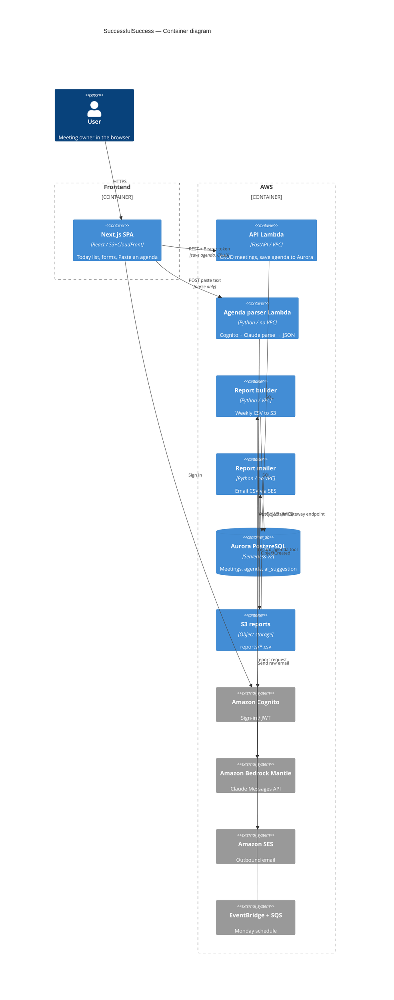

# C4 Level 2 — Containers (updated for Lab Part 4)

## Two arrows that matter for Part 4

1. **Parse:** Browser → agenda-parser Function URL → Bedrock → JSON suggestion (no database).
2. **Save:** Browser → API Lambda → Aurora (validated write; stores `ai_suggestion` JSONB).
